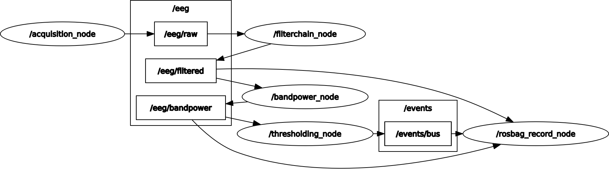

# Report of the second assignment of Neurorobotics

## Info
This ROS package implements the pipeline demanded in the second assignment of the Neurorobotics course in 25/26: \
As shown in the *threshold_on_bandpower.launch* file, the first node, the *acquisition_node*, acquires data from external devices (in our task, a given GDF file), and publishes it as **NeuroFrame** messages ([rosneuro_msgs](https://github.com/rosneuro/rosneuro_msgs)). Each published message represents a chunk of data as `samples x channels`. The request was to provide data at 512 Hz (sampling rate), and the acquisition to have a framerate of 16 Hz; hence, each **NeuroFrame** contains 32 samples (x channels) of data.
From that, the shared data is processed by the *filterchain_node* with a given sequence of filters, and shared.
Moreover, the previous output is read by the *bandpower_node*, which computes the power band of the signals.
Finally, the *thresholding_node* makes a thresholding operation to find relevant values.
Each node has been implemented in the respective *.cpp* file. \
The outgoing data from all nodes, except for the acquisition one, is registered in a ROS bag file in the *bags* folder.

The *acquisition_node* and *filterchain_node* are of those from the **RosNeuro** libraries [rosneuro_acquisition](https://github.com/rosneuro/rosneuro_acquisition) and [rosneuro_filters](https://github.com/rosneuro/rosneuro_filters), respectively. The only changes are to the input and/or output topics (to accommodate the assignment requirements), made with the remap on the *threshold_on_bandpower.launch* file. It has also been created a directory *config* with a YAML file, *MyChainCfg.yaml*, which contains the complete sequence of filters, with their parameters, to be loaded (required by the *filterchain_node*).

The header files *bandpower.h* and *thresholding.h*, their implementations *bandpower.cpp* and *thresholding.cpp*, have been built from scratch using an object-oriented programming style.

Here is a graph of the relationship between all the project nodes:


## Usage
Raw launch file line of the project:
```
roslaunch threshold_on_bandpower threshold_on_bandpower.launch
```
To change the input device, insert the path into parameter **devarg**:
```
roslaunch threshold_on_bandpower threshold_on_bandpower.launch devarg:=
```

## Material
Check before starting:
- https://github.com/rosneuro/rosneuro_msgs
- https://github.com/rosneuro/rosneuro_filters.git
- https://github.com/rosneuro/rosneuro_acquisition.git
- https://wiki.ros.org/ROS/Tutorials/Recording%20and%20playing%20back%20data

## Set Up
Paste and run in the terminal on vlab */home*, then open a new terminal in the workspace to launch the project.
### User
```
echo "source /opt/ros/noetic/setup.bash" >> .bashrc
echo "source devel/setup.bash" >> .bashrc
cd workspaces/rosneuro_ws/src/
rm -r rosneuro_tutorials
git clone https://github.com/Parelia/NeuroAssignment2.git
mv NeuroAssignment2/threshold_on_bandpower .
rm -rf NeuroAssignment2
cd ..
source /opt/ros/noetic/setup.bash
catkin_make
exit
```
### Editor
```
echo "source /opt/ros/noetic/setup.bash" >> .bashrc
echo "source devel/setup.bash" >> .bashrc
cd workspaces/rosneuro_ws/src/
rm -r rosneuro_tutorials
git init
git remote add origin https://github.com/Parelia/NeuroAssignment2.git
git pull origin master --allow-unrelated-histories
```
```
git branch --set-upstream-to=origin/master master
cd ..
source /opt/ros/noetic/setup.bash
catkin_make
exit
```

## Contributes ***
**Elia Parussolo** \
Project direction, structure definition, and problem-solving \
**Aymen Louachama** \
Programming of *bandpower_node* and *thresholding_node* \
**Elisabetta Moschella** \
Programming of *bandpower_node* and *thresholding_node* \
**Ginevra Borsetti** \
Report and code comments drafting
